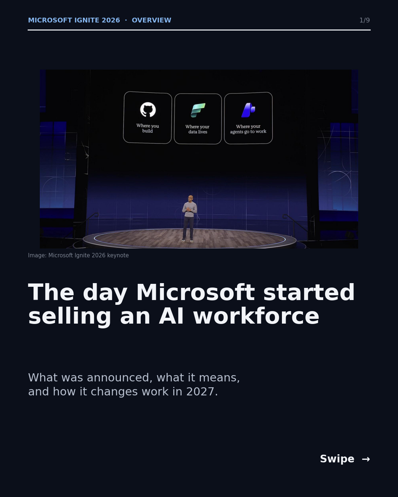
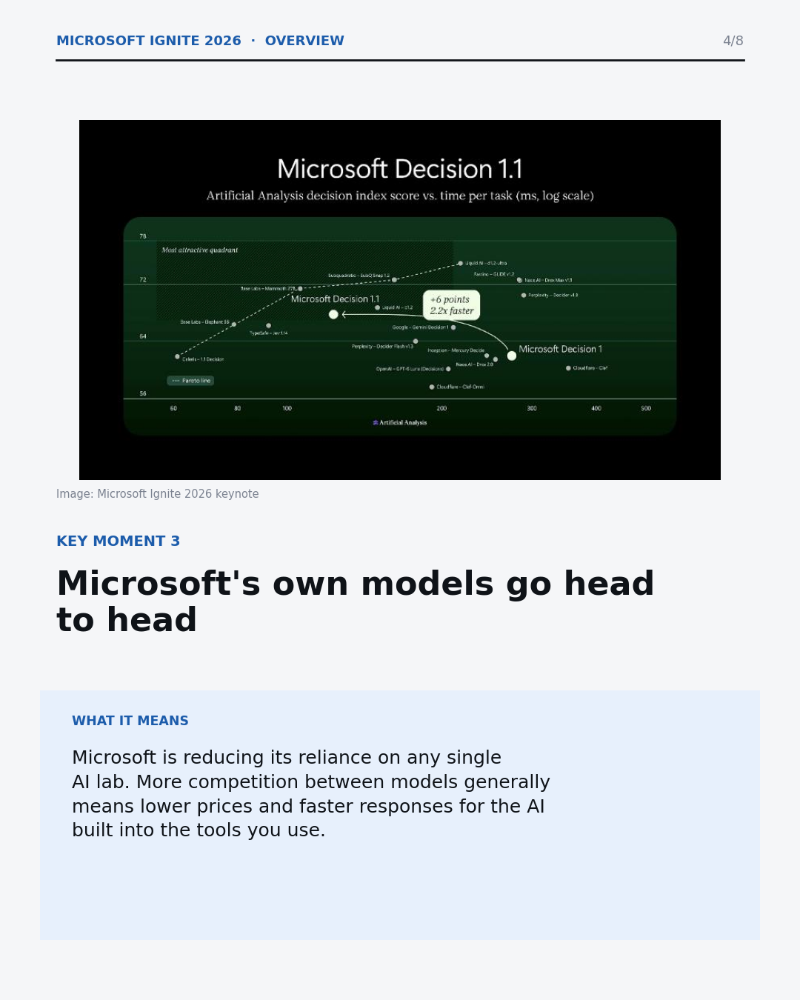
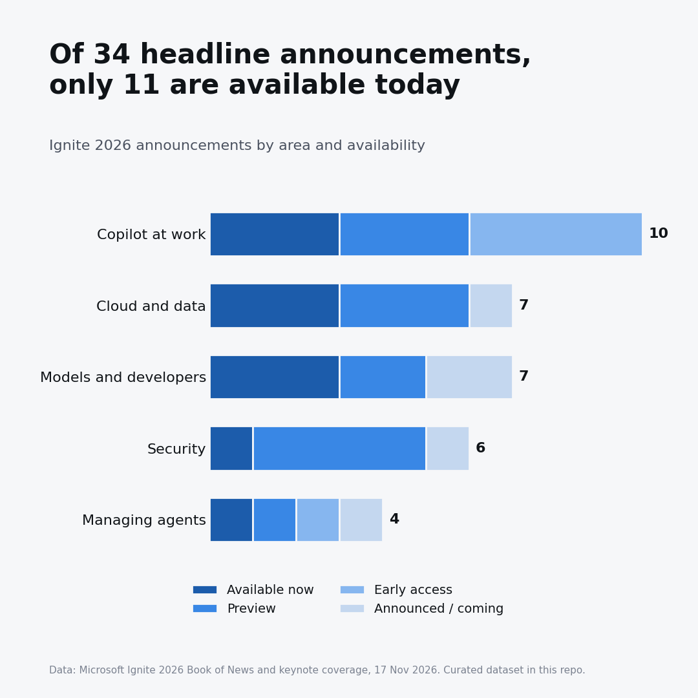
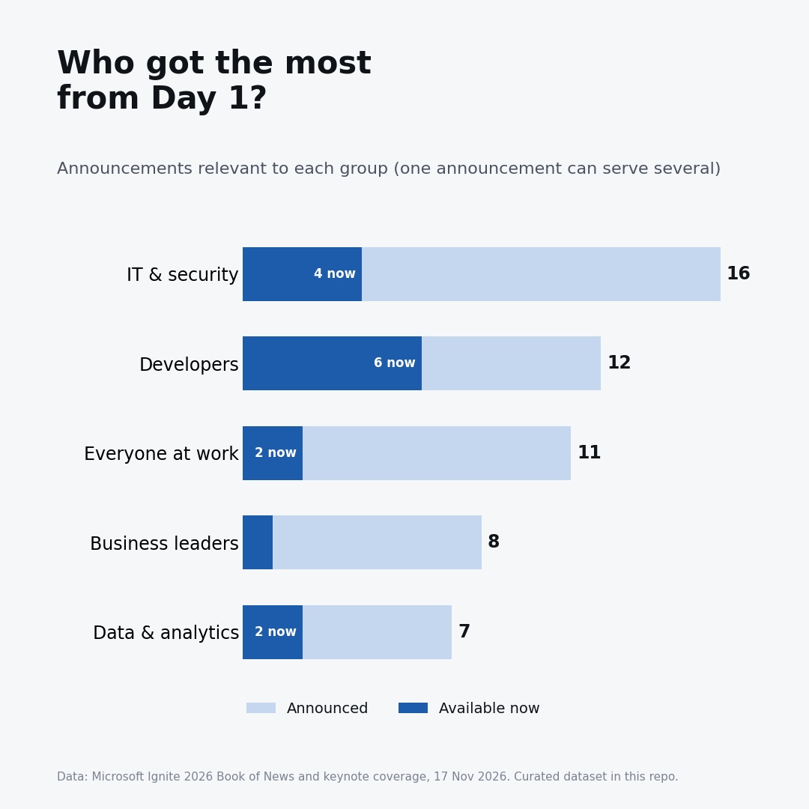

# Microsoft Ignite 2026 roundup

**Everything Microsoft announced at Ignite 2026 so far, in plain English: the best announcements, what you can use today, and what it means for 2027.** It's built as an open dataset with an interactive page and a LinkedIn carousel.

**[View the visual overview →](https://osman246.github.io/ignite-2026-roundup/)** · [All announcements, filterable](https://osman246.github.io/ignite-2026-roundup/outputs/roundup.html)

| | |
|---|---|
|  |  |

## The overview: key moments from the keynote, and what they mean

The [visual overview](https://osman246.github.io/ignite-2026-roundup/) ([source](outputs/overview.html)) is built built around high-resolution product screens from the keynote demos:

- **Microsoft 365 Copilot + Work IQ:** runs a sales review across Salesforce, Outlook and Teams, showing every step it takes.
- **Autopilot:** takes standing instructions and asks you to approve what it produces.
- **Copilot on Windows (hybrid intelligence):** combines files on your PC with web search.
- **Microsoft IQ business plugins:** packages company processes as reusable context for agents.
- **Agent 365 Business Analytics:** shows cost, estimated AI value and assisted hours for each task.
- **Microsoft 365 admin center:** finds and retires inactive agents (2,600 in the demo tenant).
- **Microsoft Foundry fine-tuning:** in an Alaska Airlines demo on synthetic data, accuracy reached 97% at $2 a month, compared with $370.

It then zooms out to **five forces shaping work in 2027** and **the skill to build in each role**, with a [LinkedIn carousel](outputs/linkedin_overview_carousel.pdf) and [post copy](LINKEDIN_POST_OVERVIEW.md).

## Day 1 in four lines

- **Copilot takes centre stage.** Microsoft now calls it "the new operating system for work". Word, Excel and PowerPoint open inside it, and agents (Autopilot, Workspaces, Copilot Code) work on tasks for you.
- **Agents get managed.** Agent 365 adds identities, cost controls and performance analytics for AI agents.
- **Microsoft's own AI.** New MAI models for code, security, images and decisions, the Maia 300 chip and Cobalt 200 servers.
- **Security first.** Microsoft Perception's security agents, Entra Agent ID, and Purview controls that keep Copilot away from sensitive files.

## What the data says

I logged **34 headline announcements** from Day 1 and tagged each one by area, availability and who it's for.

| | |
|---|---|
|  |  |

- Only **11 of 34 (32%)** are available today. The rest are in preview (13), early access (5) or announced as coming (5).
- **Developers** got the most they can use now (6 of 12). **Everyday workers** got 2 of 11, so the headline Copilot features will roll out over the coming months.

## What it means going forward

1. **Copilot is becoming the operating system for work.** The skill that matters shifts from knowing your way around Office to directing agents.
2. **Microsoft is building its own AI stack.** It now has its own models and chips, alongside OpenAI and Meta models.
3. **Agents are being managed like employees.** They get identities, budgets, performance reviews and security cover.
4. **Copilot is opening up to other vendors' tools.** Salesforce runs in Copilot, Fabric data works in ChatGPT and Claude, and there are 350+ connectors.
5. **Trust is now part of the pitch.** Microsoft announced transparency standards and tighter data controls.

The [interactive page](https://osman246.github.io/ignite-2026-roundup/outputs/roundup.html) lets you filter announcements by your role and by availability.

## Project structure

```
data/announcements.json   Curated dataset: every headline announcement, tagged by area, availability and audience
data/announcements.csv    The same data, flat (generated)
src/analyze.py            Summary stats + charts      -> outputs/summary.json, outputs/charts/
src/build_page.py         Interactive roundup page    -> outputs/roundup.html
src/carousel.py           LinkedIn carousel (1080x1350) -> outputs/linkedin_carousel.pdf, outputs/slides/
src/build_overview.py     Visual overview page        -> outputs/overview.html (uses data/outlook.json, data/keynote_moments.json)
src/overview_carousel.py  Overview carousel           -> outputs/linkedin_overview_carousel.pdf, outputs/overview_slides/
LINKEDIN_POST.md          Post copy
```

```bash
python3 -m venv .venv && source .venv/bin/activate
pip install -r requirements.txt
cd src && python analyze.py && python build_page.py && python carousel.py
```

To add Day 2 to Day 4, append items to `data/announcements.json` and rerun the three scripts.

## Sources and method

- [Microsoft Ignite 2026 Book of News](https://news.microsoft.com/events/ignite/2026/book-of-news/), the [Microsoft Source overview](https://news.microsoft.com/source/2026/11/17/microsoft-ignite-2026-empowering-human-ambition-intelligence-and-trust/) and the [live news page](https://news.microsoft.com/events/ignite/2026/live-news/).
- Availability labels follow Microsoft's wording. "Early access" covers the Frontier programme and private previews.
- A few keynote figures (50M+ agents in Agent 365, Maia 300 efficiency, GPT-6.2 coming to Foundry) come from press coverage of the keynote ([Technology Record](https://www.technologyrecord.com/article/microsoft-ignite-2026-satya-nadella-predicts-rise-of-the-software-factory), [Windows Forum](https://windowsforum.com/news/microsoft-ignite-2026-keynote-copilot-agents-ai-security-and-azure-launches-explained.452746/)) and are labelled as such.
- The list is a curated set of headline announcements, not an exhaustive count. "What it means" and "best of" are my analysis.

## Related

- [ignite-2026-briefing](https://github.com/Osman246/ignite-2026-briefing): the same announcements framed for business leaders, checked against US Census data on AI adoption.

## License

Code: MIT. Dataset and analysis text: CC BY 4.0. This is an independent analysis, not affiliated with Microsoft.

**Keynote images** in `outputs/img/` (and the slides that use them) are stills from Microsoft's official Ignite 2026 keynote replay, © Microsoft. They're used here for commentary and are **not** covered by the licences above.

## Fonts

The overview carousel uses **EB Garamond** (headlines, with italic accents) and **Inter** (labels and body), both from Google Fonts under the SIL Open Font License. They aren't committed. Download them before running `src/overview_carousel.py`:

```bash
mkdir -p fonts
curl -L -o "fonts/EBGaramond[wght].ttf"        "https://raw.githubusercontent.com/google/fonts/main/ofl/ebgaramond/EBGaramond%5Bwght%5D.ttf"
curl -L -o "fonts/EBGaramond-Italic[wght].ttf" "https://raw.githubusercontent.com/google/fonts/main/ofl/ebgaramond/EBGaramond-Italic%5Bwght%5D.ttf"
curl -L -o "fonts/Inter.ttf"                   "https://raw.githubusercontent.com/google/fonts/main/ofl/inter/Inter%5Bopsz,wght%5D.ttf"
```
